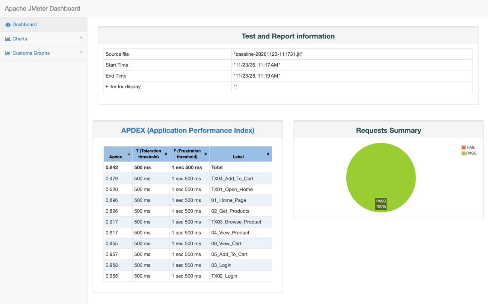
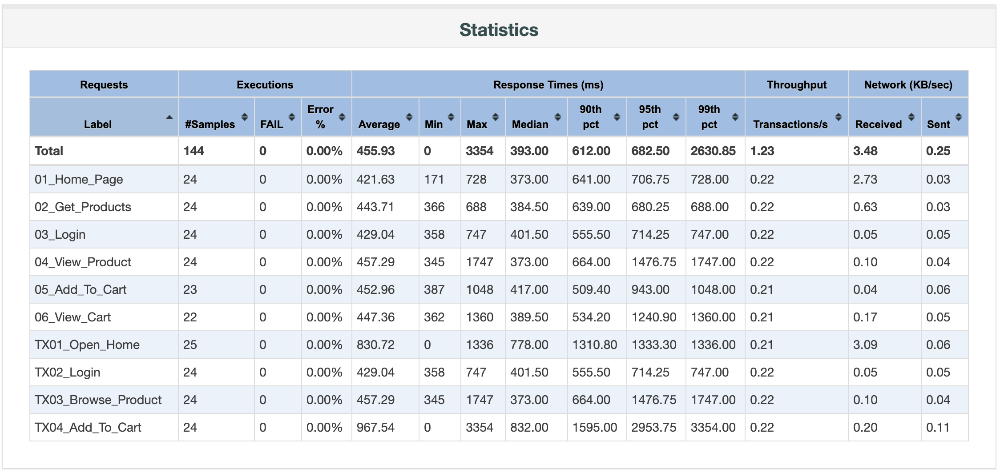

# Demoblaze Performance Testing

Apache JMeter project for measuring the performance of the Demoblaze shopping workflow.

## What I Prepared

- Performance testing project for a public e-commerce demo application
- Covers homepage access, product listing, login, product browsing, cart operations, and viewing the cart
- Uses Apache JMeter 5.6.3
- Supports baseline, load, spike, and stress test profiles
- Generates JMeter JTL results and HTML dashboards
- Demonstrates test scripting, parameterization, automation, and performance report analysis




## 1. What I Measured

The objective of this project is to evaluate response time, throughput, error rate, and transaction stability across the primary Demoblaze shopping journey.

The test plan is used to:

- Establish a baseline for normal application behavior
- Compare application response under controlled virtual-user loads
- Identify slow transactions and response-time outliers
- Verify that all executed shopping requests complete successfully
- Produce repeatable JMeter evidence for performance analysis

## 2. Which Application I Tested

- Website: `https://www.demoblaze.com`
- API host: `https://api.demoblaze.com`
- Application: Demoblaze public demo store

The workflow follows these steps:

1. Open the Demoblaze homepage.
2. Retrieve the product catalog.
3. Log in with test credentials.
4. Select a random product.
5. Add the selected product to the cart.
6. Retrieve and verify the cart.

## 3. What I Covered

| Transaction           | Requests                       |
| --------------------- | ------------------------------ |
| `TX01_Open_Home`      | Homepage and product catalog   |
| `TX02_Login`          | Login API                      |
| `TX03_Browse_Product` | Product details                |
| `TX04_Add_To_Cart`    | Add-to-cart and view-cart APIs |

| Request         | Method | Endpoint                     |
| --------------- | ------ | ---------------------------- |
| Home page       | `GET`  | `https://www.demoblaze.com/` |
| Products        | `GET`  | `/entries`                   |
| Login           | `POST` | `/login`                     |
| Product details | `POST` | `/view`                      |
| Add to cart     | `POST` | `/addtocart`                 |
| View cart       | `POST` | `/viewcart`                  |

## 4. How I Designed the Tests

- Test plan: `test-plans/demoblaze-performance.jmx`
- Virtual users: controlled by `threads`
- Ramp-up time: controlled by `rampup`
- Test duration: controlled by `duration`
- Sample error behavior: continue after sample errors
- HTTP protocol: HTTPS
- Request format: JSON
- Data source: CSV test credentials
- Product selection: random product ID from 1 to 9
- User pacing: 1-second constant delay plus up to 2-second random delay
- Login token: extracted from the login response and reused for cart requests
- Cart item ID: generated dynamically with JMeter UUID function

### Load Profiles

| Profile  | Virtual Users |     Ramp-up |    Duration |
| -------- | ------------: | ----------: | ----------: |
| Baseline |             3 |  10 seconds | 120 seconds |
| Load     |            10 |  60 seconds | 300 seconds |
| Spike    |            20 |   5 seconds | 120 seconds |
| Stress   |            25 | 300 seconds | 420 seconds |

Profiles are stored in:

- `config/baseline.properties`
- `config/load.properties`
- `config/spike.properties`
- `config/stress.properties`

## 5. How I Structured the Project

```text
demoblaze-performance-testing/
├── test-plans/                 JMeter test plans
├── test-data/                  CSV credentials
├── config/                     Load profile properties
├── scripts/                    CLI test runner
├── assets/                     Portfolio evidence
├── results/                    JTL result files
├── reports/                    HTML dashboards
└── demoblaze-performance.jmx   Fixed-load development plan
```

## 6. How I Prepared the Environment

### Step 1: Install prerequisites

- Java 8 or later
- Apache JMeter 5.6.3 or a compatible JMeter 5.x release
- Network access to Demoblaze

### Step 2: Verify installation

```bash
java -version
jmeter -v
```

### Step 3: Review test credentials

Test credentials are maintained in `test-data/test-data.csv`.

```csv
username,password
ratuser01,cmF0dXNlcjAx
ratuser02,cmF0dXNlcjAy
ratuser11,cmF0dXNlcjEx
```

The password values are Base64 encoded.

Real credentials or secrets are not included in this project.

### Step 4: Configure the CSV path

Open `CSV Data Set Config` in JMeter.

For repository-root execution:

```text
test-data/test-data.csv
```

For execution from another location, use the absolute path:

```text
/absolute/path/to/demoblaze-performance-testing/test-data/test-data.csv
```

## 7. How I Ran the Tests

### Run through the automation script

Run each profile from the repository root:

```bash
./scripts/run-test.sh baseline
./scripts/run-test.sh load
./scripts/run-test.sh spike
./scripts/run-test.sh stress
```

The script performs the following actions:

1. Loads the selected profile properties.
2. Creates timestamped JTL output.
3. Creates a timestamped JMeter log.
4. Generates an HTML report.
5. Prints the report location after successful execution.

### Run JMeter directly

```bash
jmeter -n \
  -t test-plans/demoblaze-performance.jmx \
  -l results/baseline.jtl \
  -Jthreads=3 \
  -Jrampup=10 \
  -Jduration=120
```

### Open in JMeter GUI

```bash
jmeter -t test-plans/demoblaze-performance.jmx
```

The View Results Tree listener is disabled in the parameterized plan to reduce GUI and memory overhead during load execution.

## 8. How I Generated the Reports

Create a dashboard from JTL results:

```bash
jmeter -g results/baseline.jtl \
  -o reports/baseline-dashboard
```

The dashboard includes:

- Request pass and error summary
- APDEX results
- Response-time charts
- Throughput results
- Transaction-level statistics

## 9. What I Found in the Baseline Run

### Test Details

- Profile: Baseline
- Virtual users: 3
- Ramp-up: 10 seconds
- Duration: 120 seconds
- Execution date: November 23, 2026
- Execution period: 11:17 AM to 11:19 AM
- Source result: `baseline-20261123-111731.jtl`

### Result Summary

| Metric                |                Result |
| --------------------- | --------------------: |
| Total samples         |                   144 |
| Failed samples        |                     0 |
| Error percentage      |                    0% |
| Mean response time    |                456 ms |
| Median response time  |                393 ms |
| Maximum response time |               3354 ms |
| Overall throughput    | 1.227 requests/second |
| Overall APDEX         |                 0.842 |
| Requests passed       |                  100% |

### Transaction Summary

| Transaction           | Mean Response Time |
| --------------------- | -----------------: |
| `TX01_Open_Home`      |             831 ms |
| `TX02_Login`          |             429 ms |
| `TX03_Browse_Product` |             457 ms |
| `TX04_Add_To_Cart`    |             968 ms |

Key observations:

- All recorded requests passed.
- No HTTP sample errors were recorded.
- Overall APDEX was 0.842.
- `TX04_Add_To_Cart` had the highest mean and maximum response time.
- The maximum response time reached 3354 ms.
- The cart transaction requires comparison against additional repeat runs.

## 10. How I Analyzed the Results

Each test run should be evaluated using the following metrics:

- Response time: minimum, average, median, and maximum
- Percentile response times
- Error percentage
- Transaction throughput
- Application error count
- Virtual-user concurrency
- APDEX score
- Transaction-level response-time variance

Comparison runs should use:

- The same JMeter version
- The same test environment
- The same virtual-user profile
- The same ramp-up and duration
- The same network location
- The same test data

The current test plan has no automated assertion thresholds.

## 11. Skills I Demonstrated

- JMeter test-plan development
- HTTP API load testing
- JSON request configuration
- CSV-driven test data
- Dynamic variables and JMeter functions
- Authentication token extraction
- Transaction-level measurement
- Load-profile configuration
- Command-line JMeter execution
- HTML dashboard generation
- Performance result analysis
- Repeatable test automation through shell scripting
- Test evidence documentation

## 12. Limitations I Identified

- The target application is external and not owned by this project.
- Account availability may change over time.
- Browser rendering and JavaScript execution are not simulated.
- Response caching and Think Time differ from real browser behavior.
- The public environment may limit repeatability.
- Formal SLO thresholds are not yet configured in JMeter assertions.

---
